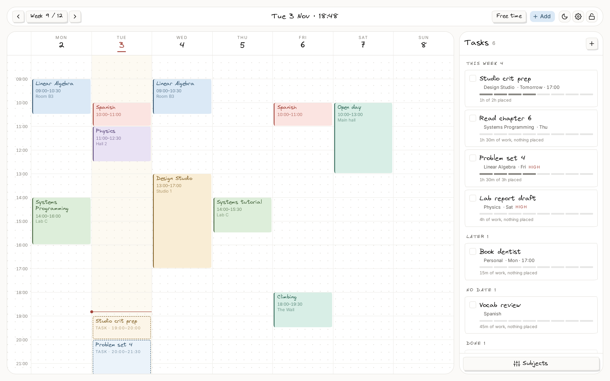
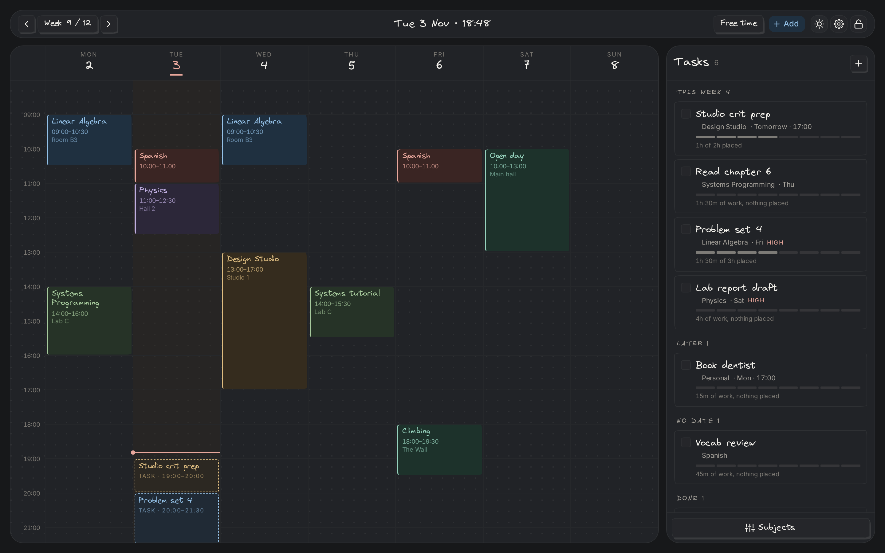

# Timetable

A week timetable that knows what time you actually have free.

Classes and other fixed commitments sit on the grid. Tasks carry a deadline
**and** an effort estimate, so the app can tell you where they fit instead of
asking you to guess. Everything lives in IndexedDB — no account, no server.



## The idea

Most calendars treat a task as an event with a start and end time, which throws
away the two things that make tasks useful: when they are **due**, and how much
**work** they are.

This app keeps those separate:

```
remaining = estimateMinutes − Σ (scheduled blocks)
```

A three-hour lab report due Friday is not "Thursday 14:00–17:00". It is three
hours of work, a deadline, and a search for somewhere to put it. The app answers
that search from the gaps between your commitments — and shows you the gaps.

Scheduling work never completes a task. A task stays open until you tick it off,
however much of it is already on the calendar.

## What it does

- **Week grid** that opens on the week containing today, with recurring
  sessions (every week, odd weeks or even weeks), dated sessions on one or more
  specific dates, and term week ranges.
- **Task panel** grouped by urgency, with a segmented bar showing how much of
  each task's estimate is already placed.
- **Free time** as a toggle: the gaps get hatched, with a duration in each.
- **Drag** a task onto the grid to book a session. The block is sized to the
  work the task has left, shortened to whatever gap you drop into, so a
  four-hour task dropped into a one-hour hole books an hour. Conflicting drops
  are refused and name what they would overlap.
- **Subjects** can be renamed and recoloured from the task panel; the change
  applies to every session using them.
- **Find a slot**: every task has a button that places it in the earliest gap
  before its deadline. This is also the keyboard and touch path — dragging is
  mouse-only on purpose.
- **Calendar lock**: with the lock on, tasks cannot be dragged onto the grid at
  all, which is what you want when you are just reading the week.
- **Light and dark** themes that follow the paper metaphor in both directions.
- **Settings** for the first day of the week, 12- or 24-hour times, the hours
  the grid covers, the theme, the lock, and the stored data.
- **Undo** on every destructive action, from a single snapshot stack.
- **Print stylesheet** that drops the chrome, keeps the colours, and puts the
  week on one page.
- **Phone layout**: a day strip and agenda list rather than a squeezed grid,
  with tasks in a bottom drawer.

## Running it

```bash
npm install
npm run dev        # http://localhost:5173
npm run build      # typecheck + production build
npm test           # domain unit tests
```

The app seeds a demo term around today's date on first load, so it is never
empty. **Settings → Reset demo data** restores it.

## How it fits together

```
src/
  domain/      pure TypeScript — no React, no Zustand, no browser APIs
  store/       Zustand slices, IndexedDB persistence, scheduling hooks
  components/  week grid, day agenda, task panel, shell, shadcn primitives
  routes/      week view and settings
  styles/      paper textures, hand-drawn geometry, fonts
```

Three rules hold it together:

1. **`domain/` imports nothing from React or the store.** It is pure functions
   over plain data, which is why 118 tests run in under half a second.
2. **Rules are stored; occurrences are computed.** A recurring class is a rule.
   The block you see in week 7 is derived from it and never persisted, so
   changing a class time updates every future week at once.
3. **Task progress is derived.** There is no stored percentage to drift.

### The scheduling engine

Free time is the set complement of busy time inside a day window:

```ts
const gaps = complementIntervals(busyIntervals(date), { start: 8 * 60, end: 23 * 60 })
```

Everything else composes on top of that: drop validation, the free-time
overlay, and "does this fit before my deadline". Two functions, about 40 lines,
and every scheduling question in the app reduces to them.

Times are integer minutes from midnight and dates are `YYYY-MM-DD` strings.
Neither ever passes through `new Date()` for arithmetic — `new Date('2026-11-05')`
parses as UTC midnight and lands on the previous day west of Greenwich.

Week starts are a setting, so nothing may assume a Monday. Occurrences resolve
their date by weekday, not by column index.

## Design notes



The interface imitates paper: a dot grid, hand-drawn borders, and pastel fills
paired with darker "pen" tones. Two constraints keep it usable:

- **Virgil carries voice, Inter carries speed.** Handwriting sets titles,
  labels and block text. Numerals, metadata and anything scanned in a list use
  Inter with tabular figures — a proportional hand font makes a column of times
  jitter.
- **Pastel fill never carries meaning alone.** Every subject is a `fill`/`pen`
  pair, defined per theme. The pen tone clears 4.5:1 against its own fill and
  drives the text and the accent bar, so the timetable still reads in greyscale
  and stays legible in dark mode.

The three panels — toolbar, calendar, tasks — are separate rounded cards inside
one padded column, so they share edges and their header rules land on the same
baseline.

## Known limits

- One term at a time; there is no term switcher.
- No sync — the data belongs to one browser profile.
- Cancelling a single session works; moving one does not (the rule would need
  a per-occurrence override).
- A session is either weekly or dated; there is no "every second Tuesday"
  rule beyond odd/even weeks.
- Tasks do not recur.
- The 12/24-hour setting formats the grid and deadlines, but not the native
  time inputs: browsers render `<input type="time">` in the OS locale.
- Dragging is mouse-only. Touch and keyboard use "find a slot".

## Stack

Vite · React 19 · TypeScript · React Router · Tailwind v4 · shadcn/ui ·
Zustand · idb-keyval · dnd-kit · react-icons · Vitest

Font and licence notes: [ASSETS.md](ASSETS.md).
